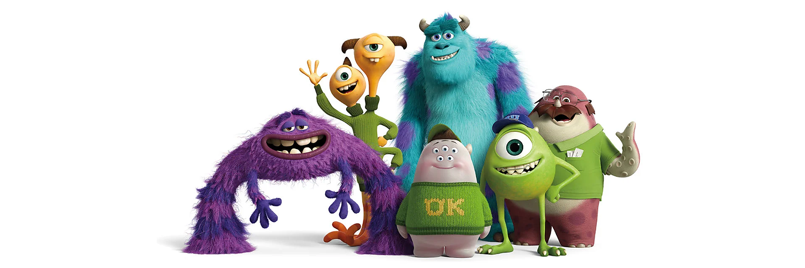

A group of college friends learning, exploring new technologies, and building projects together.

We bring together academic projects, personal experiments, and ideas we want to turn into working software. Along the way, we share what we learn and help each other grow as developers.

## What we're working on

| Project | About | Status |
| --- | --- | --- |
| [OrthoTest](https://github.com/alveslim/OrthoTest) | An academic application for recording and tracking orthopedic tests. | In Development |
| Jev Exploration | Exploring Jev and choosing a useful application to build together. | Ideas |

## How we work

- Break ideas into small, manageable tasks.
- Collaborate through issues, branches, and pull requests.
- Review each other's work and share feedback.
- Document our projects so others can understand and run them.
- Give every contributor credit for their work.

Learning together. Building together.
